

  

  <h1>Kasir TokoMu — WarungOS</h1>

  

    <strong>Retail &amp; Consignment Operating System berbasis Tablet-First Web App</strong> 
    <em>Satu Workspace Terpadu: Point of Sale, Kontrol Stok Real-Time, Akuntansi 3-Jalur Kas, Konsinyasi &amp; Bagi Hasil Otomatis, Copilot AI, hingga Laporan PDF &amp; WhatsApp Terjadwal.</em>
  

  

    
    
    
    
    
    
    
    
    
  

---

  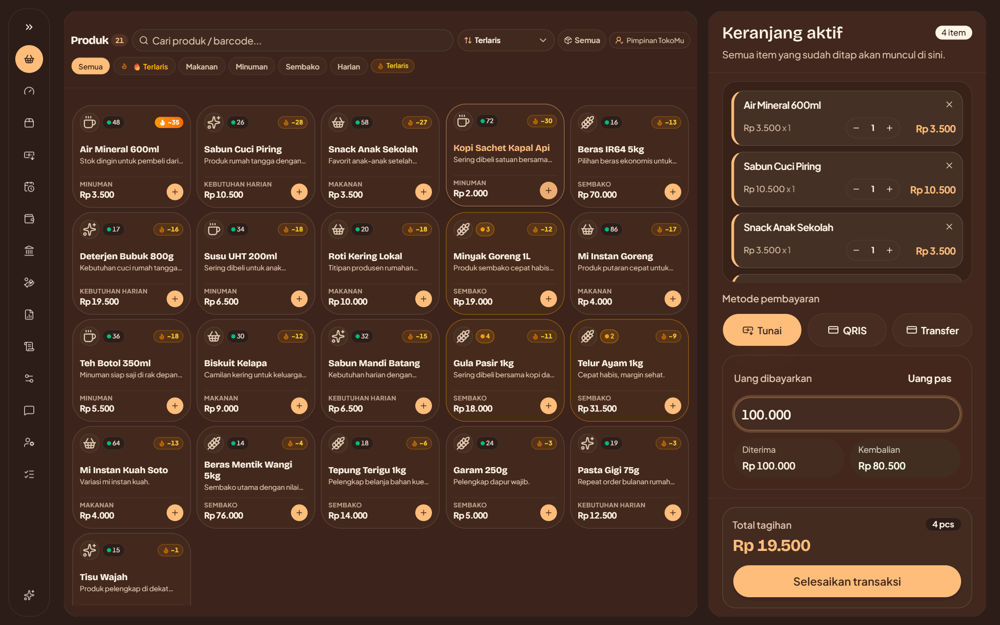

  <strong>Kasir TokoMu (WarungOS)</strong> dirancang khusus untuk kebutuhan ritel nyata di perangkat tablet maupun desktop — memadukan kecepatan transaksi kasir, ketelitian pembukuan keuangan, transparansi pemodal &amp; barang titipan, serta laporan eksekutif otomatis ke WhatsApp.

---

## Mengapa Kasir TokoMu?

Kebanyakan aplikasi kasir berhenti pada mencatat struk penjualan. **Kasir TokoMu (WarungOS)** melangkah jauh lebih dalam untuk menyelesaikan masalah nyata yang sering membuat laporan toko kelontong &amp; warung ritel terlihat *"selalu rugi di catatan meski laci kas ramai"*:

| Keunggulan Utama | Dampak Nyata di Operasional Toko |
| :--- | :--- |
| ⚡ **Tablet-First Zero-Lag UI** | Antarmuka dirancang untuk perangkat tablet kasir dengan permukaan GPU ringan, tabel tervirtualisasi (`TanStack Virtual`), dan dual tema adaptif (**Dark Espresso** &amp; **Warm Cream**). |
| 🧾 **Pemisahan 3-Jalur Kas (Bebas Laba Terpotong Ganda)** | Memisahkan tegas **Beban Operasional Murni** (*listrik, plastik, gaji*), **Nota Kulakan Supplier**, dan **Bayar Barang Titipan Konsinyasi** — lengkap dengan kalkulator untung titipan &amp; reklasifikasi 1-klik. |
| 🧠 **Analisa Mandiri &amp; Rekomendasi Profit Toko** | Sistem mengevaluasi produk margin tipis vs penyumbang laba tertinggi, deteksi restok mendesak barang cepat laku, modal tertahan di stok mengendap, serta rasio arus kas secara otomatis. |
| 🔐 **Sinkronisasi Shift Lintas Akun &amp; 3 Pos Kas** | Sesi shift aktif terbagi secara real-time di workspace (Pimpinan, Keuangan, Kasir) dengan pelacakan fisik **Laci Tunai, Receh, dan Brankas Tabungan** hingga rekonsiliasi selisih tutup shift. |
| 📲 **Auto Laporan WhatsApp + PDF &amp; Akumulasi MTD** | Scheduler OpenWA otomatis (**Harian pukul 19:00 WIB pasca-tutup shift, Mingguan, Bulanan**) mengirim lampiran PDF resmi beserta **akumulasi bagi hasil sejak awal bulan (Month-to-Date)** untuk PCM, Cadangan &amp; Toko. |
| 🤖 **Copilot Asisten AI + OCR Struk Belanja** | Asisten AI kontekstual terhubung ke basis data live untuk cek stok, hitung laba, analisis kasbon, dan mengeksekusi aksi restok/hutang dengan konfirmasi aman. |

---

## Galeri Fitur & Antarmuka

### 1. Point of Sale (POS) Dual-Theme yang Responsif & Cepat

Dirancang untuk kecepatan *tap-to-cart* di layar sentuh tablet: indikator stok real-time &amp; badge produk terlaris, filter kategori cepat, metode bayar **Tunai / QRIS / Transfer**, nominal uang pas otomatis, hingga dukungan penuh tema **Dark Espresso** dan **Warm Cream Light**.

<table>
  <tr>
    <td width="50%" valign="top">
      
      
<strong>Kasir POS — Dark Espresso Mode</strong> Keranjang aktif multi-item, tombol cepat pembayaran Tunai/QRIS/Transfer, dan kalkulasi kembalian real-time.

    </td>
    <td width="50%" valign="top">
      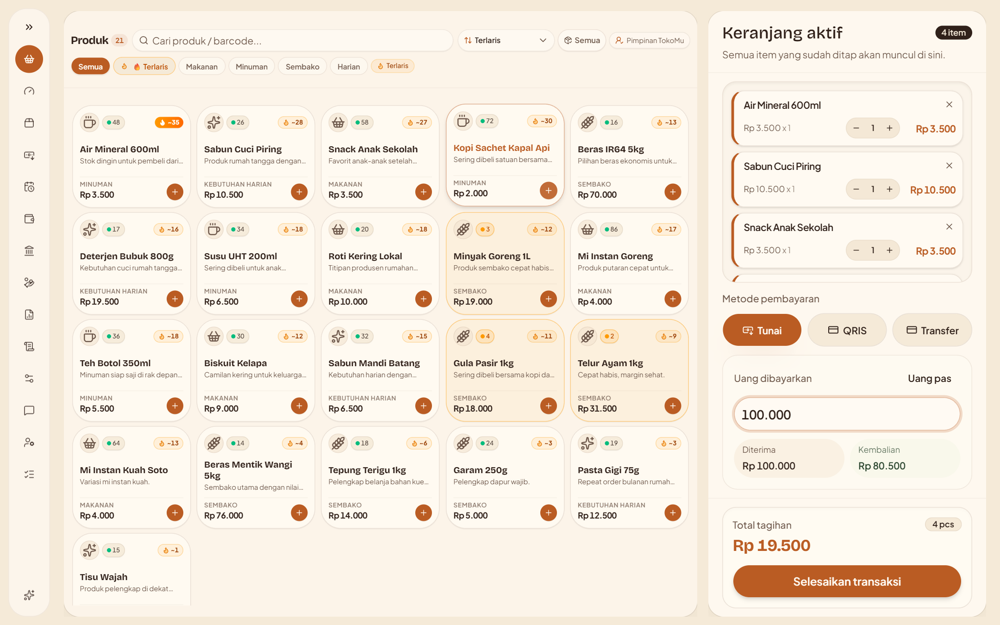
      
<strong>Kasir POS — Warm Cream Light Mode</strong> Kontras tinggi ramah mata untuk penggunaan kasir di ruangan terang dengan penanda visual stok menipis.

    </td>
  </tr>
</table>

---

### 2. Dashboard Eksekutif & Kontrol Inventaris Real-Time

Pemilik usaha dapat memantau denyut toko dalam satu pandangan — omzet berjalan, transaksi masuk, peringatan SKU rawan kosong, nilai modal tersimpan, timeline struk terakhir, dan pengelolaan katalog inventaris berkecepatan tinggi.

<table>
  <tr>
    <td width="50%" valign="top">
      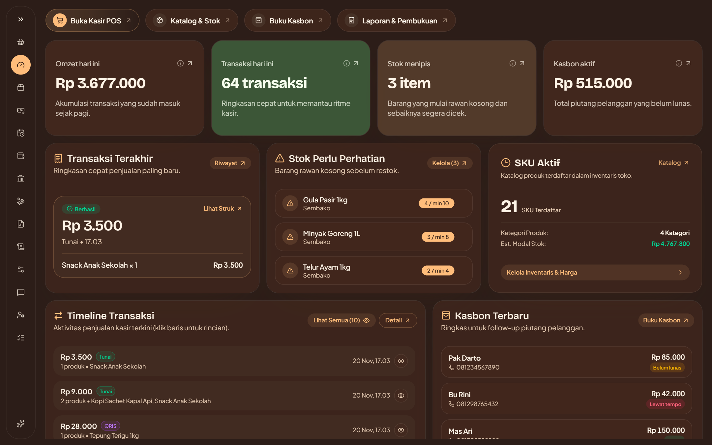
      
<strong>Dashboard Eksekutif</strong> Ringkasan KPI real-time, kartu peringatan stok kritis, timeline transaksi, serta pemantauan kasbon aktif.

    </td>
    <td width="50%" valign="top">
      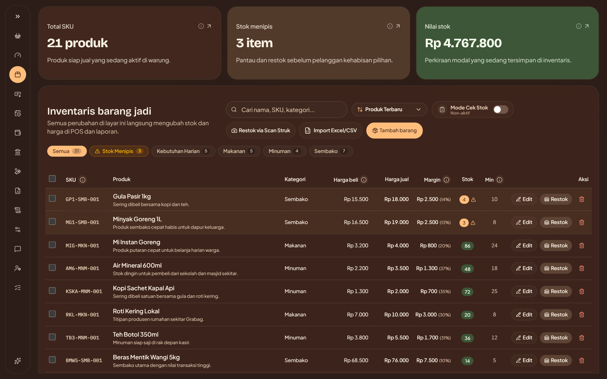
      
<strong>Manajemen Inventaris &amp; Margin</strong> Pelacakan SKU, harga beli vs jual, persentase margin per produk, impor Excel/CSV, hingga restok via scan struk.

    </td>
  </tr>
</table>

---

### 3. Disiplin Akuntansi 3-Jalur Pengeluaran & Manajemen Shift Kasir

Menjaga agar uang kulakan supplier dan setoran mitra barang titipan tetap mengurangi uang fisik di laci kasir, namun **tidak merusak perhitungan Laba/Rugi Usaha** di pembukuan.

<table>
  <tr>
    <td width="50%" valign="top">
      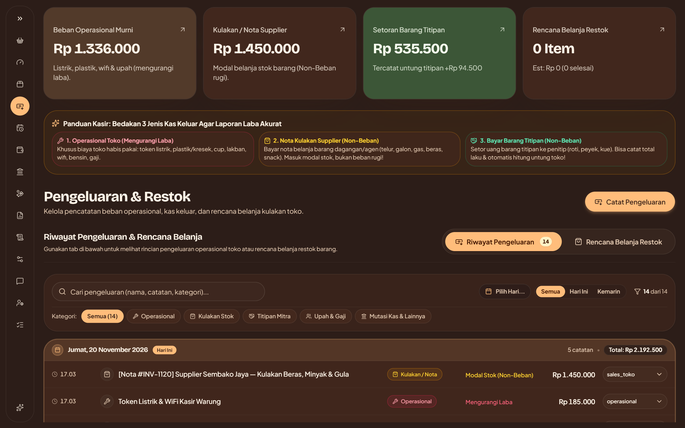
      
<strong>Pengeluaran &amp; Restok (3-Jalur Kas)</strong> Pemisahan jelas antara Beban Operasional Murni, Nota Kulakan Supplier, dan Setoran Barang Titipan + reklasifikasi 1-klik.

    </td>
    <td width="50%" valign="top">
      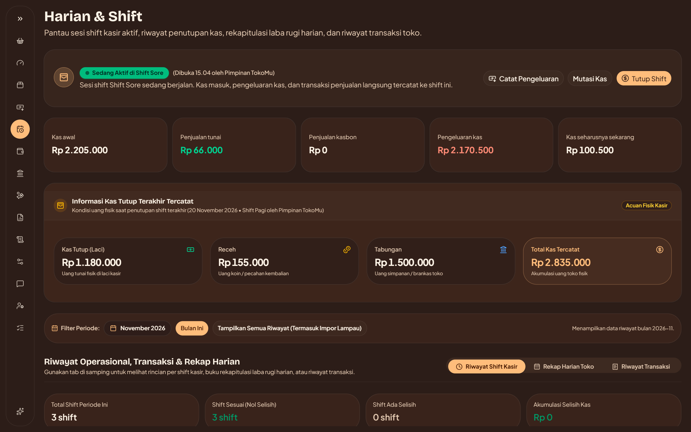
      
<strong>Harian &amp; Rekonsiliasi Shift Terpadu</strong> Pemantauan sesi shift aktif lintas kasir, rincian saldo Laci/Receh/Tabungan, rekap harian, &amp; riwayat transaksi.

    </td>
  </tr>
</table>

---

### 4. Buku Hutang Terkelompok & Kemitraan Investor / Konsinyasi

Transparansi penuh baik untuk piutang pelanggan (*kasbon*) maupun kewajiban kepada pemodal *Murabahah* dan mitra barang titipan (*konsinyasi*).

<table>
  <tr>
    <td width="50%" valign="top">
      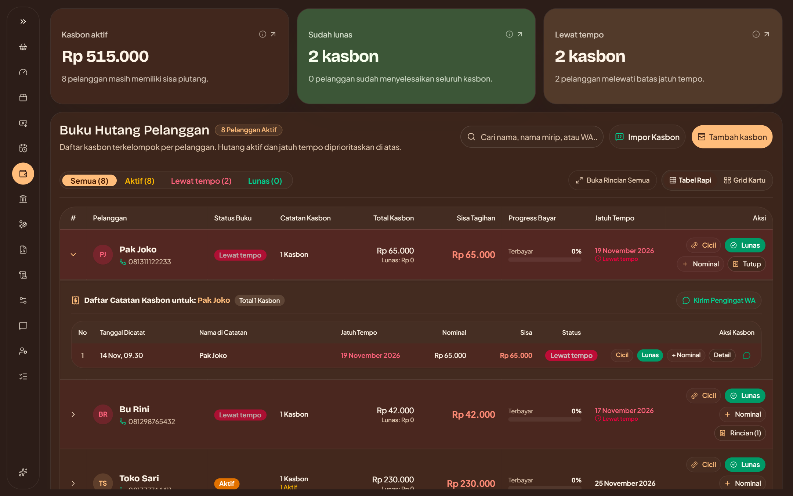
      
<strong>Buku Hutang (Kasbon) Terkelompok</strong> Dikelompokkan per pelanggan dengan prioritas jatuh tempo, rincian accordion, bayar cicilan cepat, dan pengingat WhatsApp.

    </td>
    <td width="50%" valign="top">
      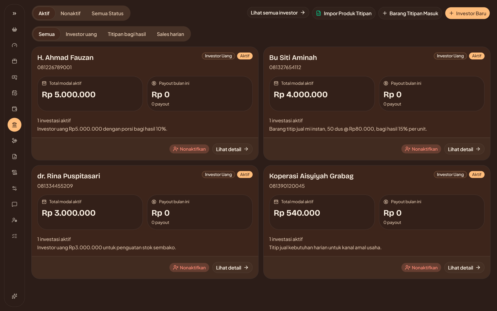
      
<strong>Manajemen Investor &amp; Konsinyasi</strong> Mendukung akad investor modal uang, barang titip bagi hasil, dan sales harian dalam satu portal kemitraan.

    </td>
  </tr>
</table>

---

### 5. Kalkulasi Bagi Hasil Real-Time & Laporan Laba Rugi Komprehensif

Perhitungan distribusi keuntungan ke pemodal maupun pembagian hasil operasional (*PCM, Kas Cadangan, dan Pelaksana Toko*) tersinkron otomatis dari data penjualan aktual tanpa hitung manual ulang.

<table>
  <tr>
    <td width="50%" valign="top">
      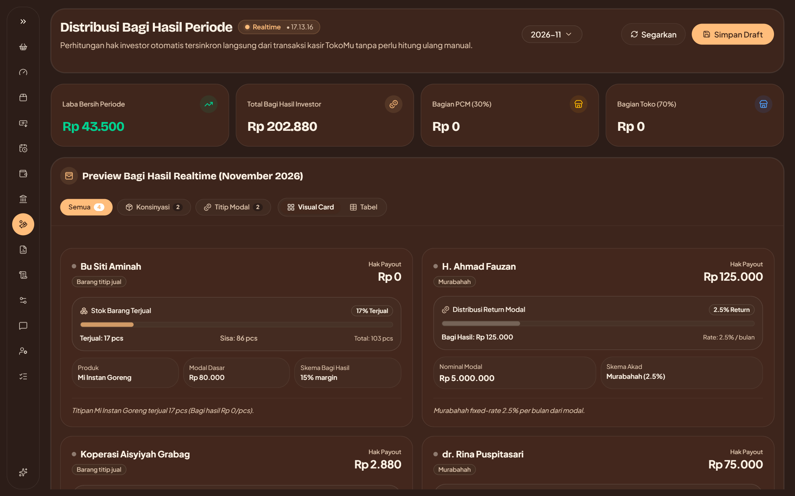
      
<strong>Distribusi Bagi Hasil Real-Time</strong> Simulasi &amp; penetapan hak payout investor berbasis realisasi penjualan item konsinyasi maupun akad pemodal.

    </td>
    <td width="50%" valign="top">
      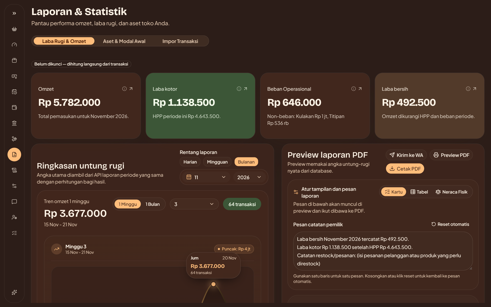
      
<strong>Laporan Laba Rugi &amp; Tren Penjualan</strong> Rekap Harian, Mingguan, dan Bulanan dengan pemisahan HPP, Beban Murni, dan Non-Beban Stok, siap pratinjau &amp; cetak PDF.

    </td>
  </tr>
</table>

---

### 6. Analisa Profit Mandiri & Laporan Pertanggungjawaban PCM

Membantu pemilik warung yang bermain di margin tipis sembako agar tetap profit — lengkap dengan dokumen pertanggungjawaban resmi siap cetak untuk pimpinan cabang/persyarikatan.

<table>
  <tr>
    <td width="50%" valign="top">
      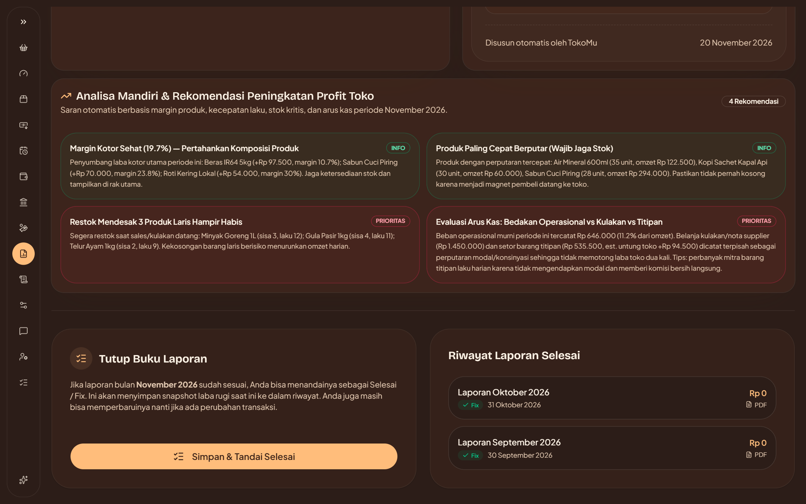
      
<strong>Analisa Mandiri &amp; Rekomendasi Profit Toko</strong> Deteksi otomatis produk margin sehat, barang cepat berputar, peringatan restok kritis, hingga evaluasi arus kas.

    </td>
    <td width="50%" valign="top">
      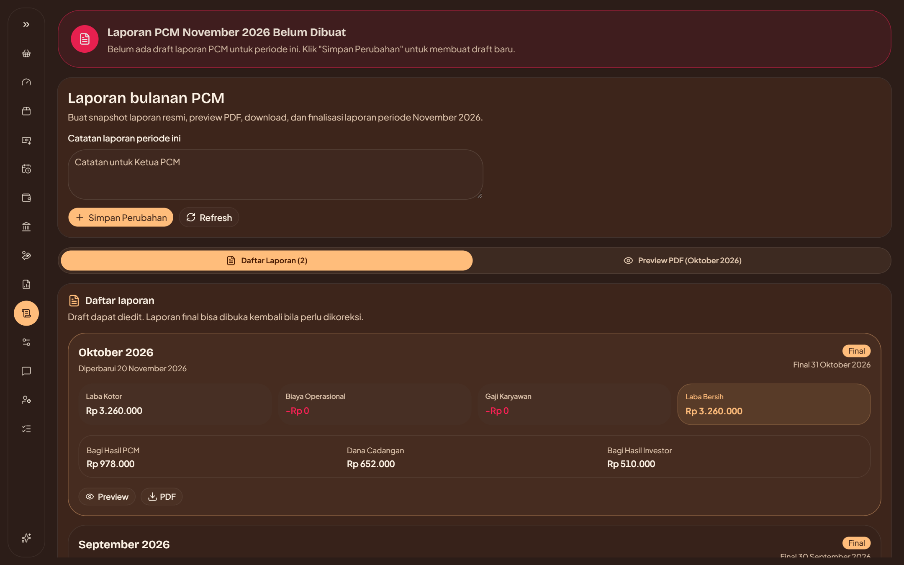
      
<strong>Laporan Resmi Bulanan PCM</strong> Snapshot laporan periodik yang dapat dikunci, dilengkapi catatan pimpinan, rincian bagi hasil, dan ekspor PDF siap cetak.

    </td>
  </tr>
</table>

---

### 7. Otomatisasi WhatsApp OpenWA & Copilot Asisten AI TokoMu

Pemilik usaha tidak perlu lagi membuka dashboard setiap malam — ringkasan eksekutif (termasuk **akumulasi bagi hasil sejak awal bulan**), 2 paragraf rekomendasi cerdas, dan dokumen PDF lengkap dikirim langsung ke WhatsApp.

<table>
  <tr>
    <td width="50%" valign="top">
      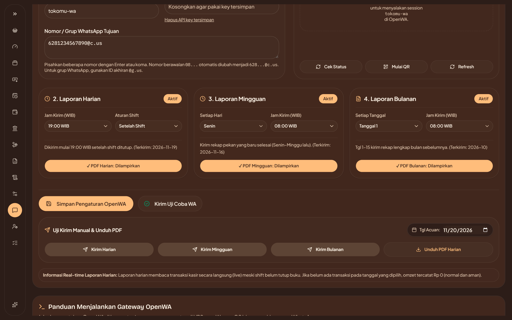
      
<strong>Integrasi OpenWA &amp; Penjadwalan Tablet-Ready</strong> Konfigurasi pairing QR OpenWA, pengiriman otomatis Harian (pasca-tutup shift), Mingguan, &amp; Bulanan beserta PDF.

    </td>
    <td width="50%" valign="top">
      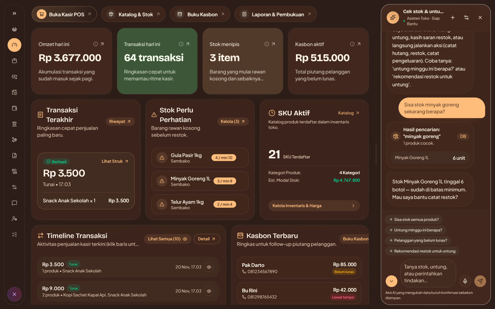
      
<strong>Asisten AI Kontekstual Berbasis Data Toko</strong> Tanya sisa stok, omzet mingguan, piutang belum lunas, atau minta saran restok lewat tool-calling langsung ke PostgreSQL.

    </td>
  </tr>
</table>

---

## Arsitektur Sistem & Tech Stack

  

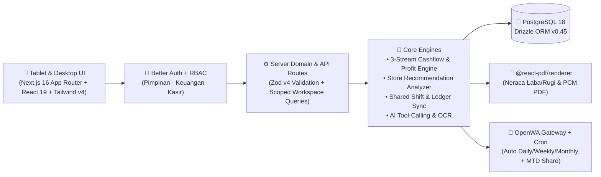

| Lapisan | Teknologi & Pustaka | Peran dalam Sistem |
| :--- | :--- | :--- |
| **Framework & Runtime** | `Next.js 16.2` (App Router, Turbopack), `React 19.2`, `TypeScript 5` | Rendering *hybrid server/client*, API routes, &amp; manajemen bundle ringan untuk tablet |
| **UI & Styling** | `Tailwind CSS v4`, `shadcn/ui`, `Base UI`, `Lucide React`, `@tanstack/react-virtual` | Design system responsif dua tema, komponen aksesibel, &amp; virtualisasi tabel stok/transaksi |
| **Database & ORM** | `PostgreSQL`, `Drizzle ORM v0.45`, `pg` | Skema relasional terindeks, transaksi atomik kasir/shift/hutang, &amp; migrasi terkontrol |
| **Autentikasi & Keamanan** | `Better Auth v1.5`, `Zod v4` | Manajemen sesi aman berbasis database, *1-click cashier switch*, RBAC ketat, &amp; audit log |
| **Dokumen & Ekspor** | `@react-pdf/renderer`, `xlsx`, `qrcode` | Pembuatan laporan resmi neraca keuangan PDF multi-seksi, struk QR, &amp; ekspor spreadsheet |
| **Otomatisasi & Messaging** | `OpenWA` HTTP Gateway Client + Internal WIB Scheduler | Pengiriman pesan ringkasan eksekutif &amp; PDF otomatis setelah shift tutup buku |
| **Kecerdasan Buatan** | LLM Tool-Calling &amp; Vision OCR (`DeepSeek` / `Gemini` / `Kimi`) | Chatbot analitik berbasis data live toko &amp; pemindaian nota belanja supplier |
| **Quality Assurance** | `Vitest`, `Testing Library`, `Playwright`, `MSW`, `pg-mem` | Pengujian unit kalkulasi finansial/timezone, E2E UI verification, &amp; simulasi database |

---

## Tata Kelola Akses (RBAC Matrix)

Setiap anggota tim bekerja dalam **satu workspace toko bersama**, dengan batasan wewenang yang jelas agar operasional kasir cepat tanpa mengorbankan keamanan data keuangan:

| Modul / Fitur | Kasir | Pengelola Keuangan | Pimpinan |
| :--- | :---: | :---: | :---: |
| **Kasir POS, Buka/Tutup Shift, &amp; Buku Hutang** | ✅ | ✅ | ✅ |
| **Inventaris &amp; Catat Pengeluaran (Operasional / Kulakan / Titipan)** | ✅ | ✅ | ✅ |
| **Harian &amp; Shift + Riwayat Transaksi** | ✅ | ✅ | ✅ |
| **Laporan Laba Rugi, PDF &amp; Pengaturan WhatsApp OpenWA** | 🔒 Terbatas | ✅ | ✅ |
| **Investor, Bagi Hasil, &amp; Analisa Strategi Profit** | ❌ | ✅ | ✅ |
| **Laporan Resmi PCM, Kelola Karyawan, &amp; Audit Log** | ❌ | 🔒 Baca | ✅ Penuh |

---

  <strong>Kasir TokoMu (WarungOS)</strong> — Dibangun untuk memberdayakan UMKM &amp; toko ritel modern Indonesia dengan pembukuan yang jujur, cepat, dan otomatis.

